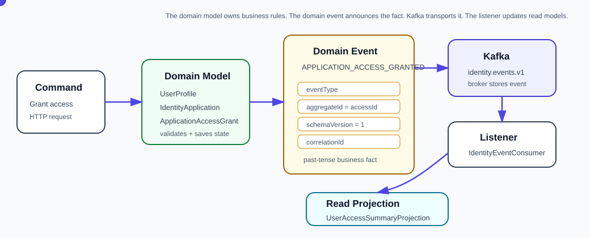

# Account Profile and Authentication Event Lab

An enterprise-shaped Spring Boot + Kafka sample plus a reusable, config-driven event quality testing framework.

The app includes a small account profile and authentication service as a reference producer of events:



1. REST command APIs manage user profiles, credentials, sign-in attempts, password reset requests, and user status.
2. Each command persists the operational record in H2.
3. The command emits an `AccountEvent` to Kafka topic `account.events.v1`.
4. A Spring Kafka consumer tracks consumed events with topic, partition, offset, correlation id, and payload JSON.
5. The Event Quality Testing Graph turns consumed events into a journey graph and deterministic advisor findings.
6. Tests separate API integration concerns from Kafka/event-flow concerns.

## What Makes This Project Different

Kafka validation is not just message assertion; it is journey-level QA.

This project adds a self-contained event intelligence layer:

- **Event Quality Testing Graph**: builds graph nodes and edges from consumed Kafka events.
- **Config-driven advisor**: applies deterministic rules from `app.assurance`, so teams can change lifecycle assertions without Java edits.
- **Testing recommendations**: reads configured recommendations for API integration, Kafka integration, contract/schema, and UI/e2e tests.
- **Interactive report metrics**: exposes metadata completeness, offset span, consumer lag, journey duration, and graph hotspots.
- **Project Context Pack**: stores application vocabulary, lifecycles, ownership, and test boundaries in `docs/event-quality-testing-context.md`.
- **Event Quality Testing Config Assistant**: creates or reviews starter `app.assurance` YAML from the context pack plus supplied artifacts, with deterministic local mode and optional request-scoped BYOK AI mode.

No live AI key, vector database, or graph database is required for the default flow. The "agentic" value starts with deterministic reasoning over event evidence; BYOK AI is optional and scoped to assurance configuration help.

The account domain is optional sample material. The reusable framework lives in `com.example.kafkaeventlab.assurance` and is configured through `app.assurance` in `application.yml`.
For larger environments, the quality testing engine reads normalized evidence through `EventEvidenceSource`; JPA/H2 is just the default local source.

## Tech Stack

- Java 17
- Spring Boot 3.5.x
- Spring Web, Validation, Data JPA, Actuator
- Spring for Apache Kafka
- Apache Kafka 4 in KRaft mode for local development
- Testcontainers Kafka for CI-style Kafka tests
- H2 in-memory database
- Maven

## Quick Start

Start Kafka:

```bash
docker compose up -d
```

Run the app:

```bash
mvn spring-boot:run
```

Register a user:

```bash
curl -X POST http://localhost:8080/api/accounts/users \
  -H "Content-Type: application/json" \
  -d '{
    "email": "anika.rao@example.com",
    "displayName": "Anika Rao",
    "department": "Finance",
    "jobTitle": "Controller"
  }'
```

Activate the user:

```bash
curl -X POST http://localhost:8080/api/accounts/users/<subjectId>/status \
  -H "Content-Type: application/json" \
  -d '{
    "status": "ACTIVE",
    "reason": "HR onboarding completed"
  }'
```

Register a credential reference:

```bash
curl -X POST http://localhost:8080/api/accounts/credentials \
  -H "Content-Type: application/json" \
  -d '{
    "userId": "<subjectId>",
    "credentialType": "PASSWORD_HASH",
    "credentialReference": "password-hash:v1:anika",
    "mfaEnabled": true
  }'
```

Sign in:

```bash
curl -X POST http://localhost:8080/api/accounts/sign-ins \
  -H "Content-Type: application/json" \
  -d '{
    "email": "anika.rao@example.com",
    "credentialReference": "password-hash:v1:anika"
  }'
```

Request password reset:

```bash
curl -X POST http://localhost:8080/api/accounts/password-reset-requests \
  -H "Content-Type: application/json" \
  -d '{"email": "anika.rao@example.com"}'
```

Inspect read-side data:

```bash
curl http://localhost:8080/api/accounts/users
curl http://localhost:8080/api/accounts/users/<subjectId>/credentials
curl http://localhost:8080/api/accounts/users/<subjectId>/sign-in-attempts
curl http://localhost:8080/api/accounts/users/<subjectId>/password-reset-requests
curl http://localhost:8080/api/accounts/tracked-events
```

Inspect event intelligence:

```bash
curl http://localhost:8080/api/assurance/subjects/<subjectId>/journey
curl http://localhost:8080/api/assurance/subjects/<subjectId>/findings
curl http://localhost:8080/api/assurance/testing-recommendations
```

Open the report view:

```text
http://localhost:8080/assurance-report.html?subjectId=<subjectId>
```

The optional Kafka UI service has been removed due to unresolved upstream vulnerabilities.

H2 console:

```text
http://localhost:8080/h2-console
```

JDBC URL:

```text
jdbc:h2:mem:kafkaeventlab
```

## Project Structure

```text
src/main/java/com/example/kafkaeventlab
├── config
│   └── KafkaTopicConfig
├── account
    ├── api          command/query controllers and API errors
    ├── application  command DTOs and use-case service
    ├── domain       durable account/profile/auth records and repositories
    ├── event        AccountEvent and Kafka publisher
    └── tracking     Kafka consumer and consumed-event audit log
└── assurance         config-driven event graph, advisor, APIs, and report models
```

## Test Layout

- `AccountApiIntegrationTests`: API + validation + service + JPA + assurance endpoints. Kafka publisher is mocked because broker behavior is not the point of this level.
- `EventAssuranceAdvisorTests`: config-driven advisor rules without Spring or Kafka.
- `AccountKafkaIntegrationTests`: Spring Boot + Testcontainers Kafka + real producer/consumer + consumed-event tracking and assurance graph assertions.

See [docs/account-testing-strategy.md](docs/account-testing-strategy.md).

For the reusable framework configuration model, see [docs/universal-event-assurance-framework.md](docs/universal-event-assurance-framework.md).

Before using the assistant on a real project, fill in [docs/event-quality-testing-context.md](docs/event-quality-testing-context.md). The assistant can include that committed Markdown file automatically, while the advisor still runs from deterministic YAML and observed evidence.

For the flow diagrams and visual explanation, see [docs/event-assurance-visual-story.md](docs/event-assurance-visual-story.md).

For a blog-style write-up, see [docs/medium-account-kafka-testing.md](docs/medium-account-kafka-testing.md).
