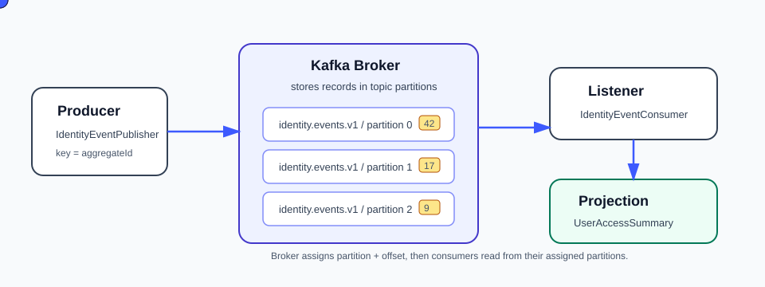
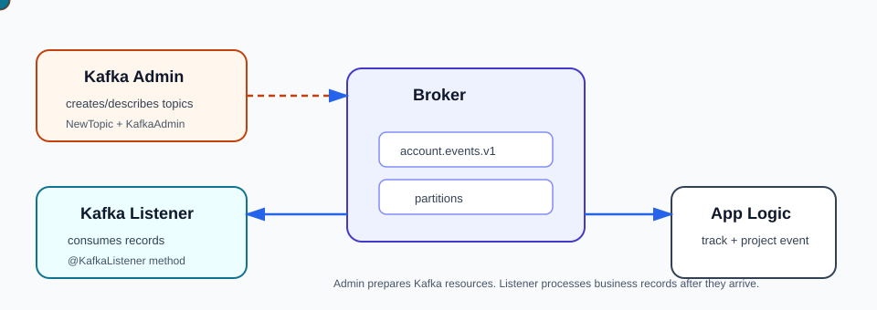

# Concepts With Project Instances

## Command API

Example:

```text
POST /api/accounts/users
```

The controller validates the request and delegates to `AccountCommandService`.

## Domain Model


A domain model is the code representation of the business concepts, rules, and lifecycle of the system.

In this project, the digital account profile and authentication service domain model includes:

- `UserProfile`
- `UserCredential`
- `SignInAttempt`
- `PasswordResetRequest`
- `UserStatus`
- `CredentialStatus`
- `AuthenticationResult`
- `PasswordResetStatus`

These are not Kafka concepts. They are account concepts. Kafka is only the transport used to publish facts about changes in this model.

Example:

```text
UserProfile
  -> has email, display name, department, job title, status
  -> can move from PENDING_ACTIVATION to ACTIVE or SUSPENDED
```

The domain model answers: "What does this business system know and what rules does it enforce?"

## Durable Write Model

Examples:

- `UserProfile`
- `UserCredential`
- `SignInAttempt`
- `PasswordResetRequest`

These represent current operational records owned by the digital account profile and authentication service.

## Kafka Broker



A Kafka broker is a Kafka server.

Its role is to receive, store, and serve records for Kafka topics. A Kafka cluster is made of one or more brokers. In local development, this project runs one broker through `docker-compose.yml`.

The broker does this work:

- accepts records from producers
- stores records in topic partitions
- assigns offsets inside each partition
- serves records to consumers
- tracks consumer group offset commits
- replicates partition data in multi-broker clusters
- coordinates with other brokers for partition leadership

In this project:

```text
AccountEventPublisher
  -> sends AccountEvent to Kafka broker
  -> broker stores it in account.events.v1
  -> AccountEventConsumer reads it from the broker
```

The broker is not business logic. It does not know what a user, credential, sign-in attempt, or password reset means. It only stores and delivers records.

## Kafka Topic And Partition

Topic:

```text
account.events.v1
```

A topic is a named stream of records. Producers write to it; consumers read from it.

Partition:

```text
account.events.v1 partition 0
account.events.v1 partition 1
account.events.v1 partition 2
```

A partition is an ordered log inside a topic. Ordering is guaranteed within one partition, not across the whole topic.

## Domain Event

Example:

```text
PASSWORD_RESET_REQUESTED
```

The event says something meaningful happened. It is not just a copy of an API response.

A domain event is a past-tense business fact emitted by the domain model.

Examples:

- `USER_REGISTERED`
- `USER_PROFILE_UPDATED`
- `USER_STATUS_CHANGED`
- `CREDENTIAL_REGISTERED`
- `SIGN_IN_SUCCEEDED`
- `SIGN_IN_FAILED`
- `PASSWORD_RESET_REQUESTED`
- `PASSWORD_RESET_COMPLETED`

The event should be explicit enough that another service can understand what happened without knowing which API endpoint caused it.

## Account Event Metadata

Each `AccountEvent` carries both business data and technical metadata.

| Field | Meaning | Example |
| --- | --- | --- |
| `eventId` | Unique id for this event instance | `46d7f58f-...` |
| `eventType` | Business fact that happened | `PASSWORD_RESET_REQUESTED` |
| `aggregateType` | Kind of business object changed | `PASSWORD_RESET` |
| `aggregateId` | Id of the business object changed | reset request id |
| `subjectUserId` | User affected by the event | user id |
| `correlationId` | Trace id connecting related work | request or workflow id |
| `occurredAt` | Business time of the event | timestamp |
| `schemaVersion` | Payload contract version | `1` |
| `data` | Event-specific business payload | profile, credential, sign-in, or reset details |

## Aggregate And Aggregate Id

An aggregate is a business object whose changes should be treated as one consistency boundary.

In this project:

| Aggregate | Aggregate id |
| --- | --- |
| user profile | `userId` |
| credential | `credentialId` |
| sign-in attempt | `signInAttemptId` |
| password reset | `resetRequestId` |

The aggregate id is used as the Kafka record key. That keeps lifecycle events for the same aggregate on the same Kafka partition.

Example:

```text
PASSWORD_RESET_REQUESTED(reset-1)
PASSWORD_RESET_COMPLETED(reset-1)
```

Both records use `reset-1` as key, so Kafka routes them to the same partition and preserves their order.

## Schema Version

`schemaVersion` identifies the shape of the event payload.

Example:

```text
schemaVersion = 1
```

If a future version adds fields, renames fields, or changes payload structure, producers can emit `schemaVersion = 2`. Consumers can then decide how to handle old and new versions safely.

Schema versioning is what lets enterprise event contracts evolve without breaking every consumer at once.

## Correlation Id

`correlationId` is a trace id for connecting related operations across logs, events, and services.

Example flow:

```text
HTTP request starts with correlationId abc-123
  -> user is activated
  -> USER_STATUS_CHANGED is published with correlationId abc-123
  -> consumer logs projection update with correlationId abc-123
```

When a production issue happens, correlation id helps you ask: "Which API call, event, consumer action, and database update belonged to the same workflow?"

## Kafka Topic

```text
account.events.v1
```

This topic carries account lifecycle events. The version suffix lets consumers migrate safely when event contracts evolve.

## Kafka Admin



Kafka admin means the administrative client/functionality used to manage broker resources.

In Spring Boot, Kafka admin is usually represented by Spring's `KafkaAdmin` auto-configuration plus `NewTopic` beans.

In this project:

```java
@Bean
NewTopic accountEventsTopic(...)
```

That bean tells Spring Kafka to ask the broker to create or validate the `account.events.v1` topic when the application starts.

Kafka admin is used for infrastructure-level work:

- create topics
- describe topics
- change topic configuration
- check cluster metadata
- inspect consumer groups

Kafka admin is not used to process business events. It prepares and manages Kafka resources.

## Kafka Listener

A Kafka listener is application code that subscribes to a topic and runs when records arrive.

In this project:

```java
@KafkaListener(topics = "${app.kafka.account-events-topic}", groupId = "${spring.kafka.consumer.group-id}")
```

This annotation makes `AccountEventConsumer.consume(...)` a Kafka listener.

Its work:

- poll records from the broker
- deserialize the record value into `AccountEvent`
- receive metadata such as topic, partition, and offset
- run business-side consumption logic
- commit offsets according to the configured listener container behavior

In our app, the listener:

```text
reads AccountEvent
  -> saves AccountTrackedEvent
```

## Consumer Group

```text
account-event-tracker
```

Consumers in the same group divide partitions among themselves.

## Event Tracking

`AccountTrackedEvent` stores:

- event id
- event type
- aggregate type and id
- subject user id
- correlation id
- topic
- partition
- offset
- payload JSON

That gives you auditability and makes test assertions precise.

## Full Business Operation To Event Flow


Example: complete a password reset.

```text
POST /api/accounts/password-resets/complete
  -> AccountCommandController
  -> AccountCommandService
  -> validates password reset request exists and is REQUESTED
  -> saves a new PASSWORD_HASH credential reference
  -> marks PasswordResetRequest as COMPLETED
  -> creates AccountEvent with:
       eventType = PASSWORD_RESET_COMPLETED
       aggregateType = PASSWORD_RESET
       aggregateId = resetRequestId
       subjectUserId = userId
       schemaVersion = 1
       correlationId = generated trace id
  -> AccountEventPublisher sends event to Kafka
  -> Kafka broker stores event in account.events.v1
  -> AccountEventConsumer receives event
  -> AccountTrackedEvent stores audit metadata
```

This is the key separation:

- command API handles the user request
- domain model enforces business state
- domain event announces what happened
- Kafka broker stores and delivers the event
- listener consumes the event
- tracking supports audit and test verification use cases
