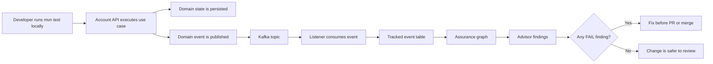
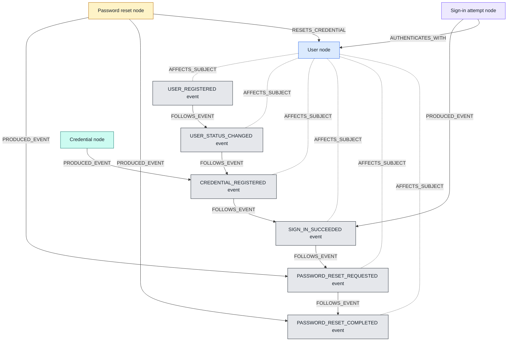
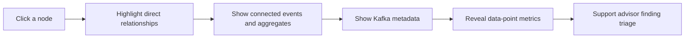
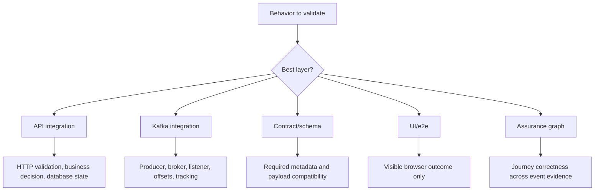

# Account Event Assurance Visual Story

This project treats Kafka events as test evidence. The assurance layer converts that evidence into a journey graph, applies deterministic advisor rules, and shows precise metrics that help a developer decide whether the behavior is healthy before merge.

## Shift-Left Flow

## Evidence Graph

## What The Interactive Graph Should Answer

The report focuses on precise metrics instead of broad dashboard noise:

- `metadataCompleteEvents`: how many consumed events contain required event metadata.
- `missingMetadataEvents`: how many events would be unsafe for consumers or contract tests.
- `sequenceEdges`: how much lifecycle ordering evidence exists.
- `offsetSpan`: how far the consumed records span in Kafka offsets.
- `averageConsumeLagMillis`: average delay between event occurrence and listener tracking.
- `journeyDurationMillis`: duration from first observed event to last observed event.
- `mostConnectedNodeId` and `mostConnectedNodeDegree`: the graph hotspot for the journey.

## Scalable Testing Boundary

The intended direction is a dynamic framework: account authentication is the reference domain, but lifecycle rules, metadata expectations, edge mappings, and test-layer recommendations should eventually move into configuration such as `event-assurance.yml` or be derived from AsyncAPI.
